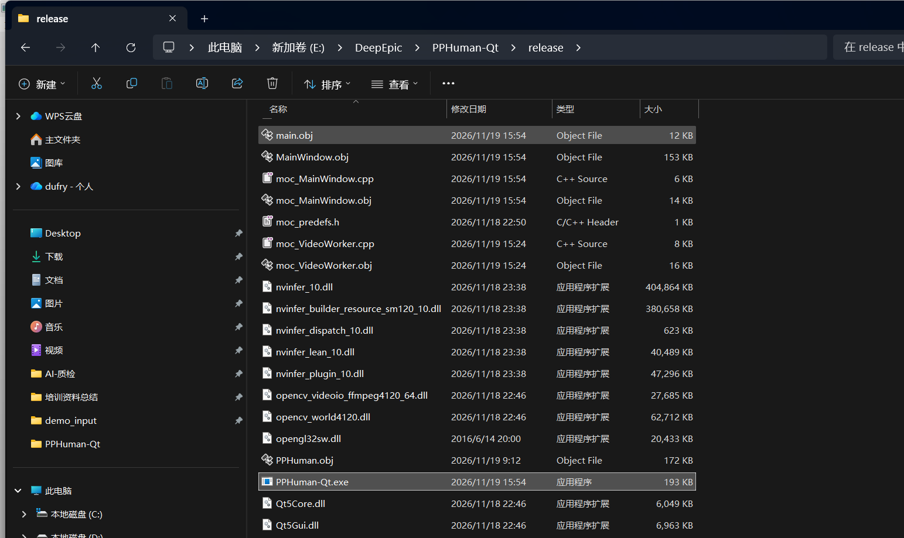

# PPHuman-Qt

PP-Human 行为分析（C++/Qt5 + TensorRT）桌面端。与仓库根目录的 Python 版对应：Python 版负责模型转换与算法对照，本项目负责多路实时运行与工业报警。



## 依赖

| 组件 | 版本 |
| --- | --- |
| Qt | 5.14.2 msvc2017_64 |
| OpenCV | 4.12.0 (opencv_world4120) |
| TensorRT | 10.16.1.11 |
| CUDA | 12.9 |
| MSVC | VS2022 14.44 + WinSDK 10.0.26100 |

路径在 `PPHuman-Qt.pro` 里改（`OPENCV` / `TRT` / `CUDA`），然后 `qmake` + `nmake`，或直接用 `build.bat`。

## 模型

仓库不含权重。先用根目录 Python 环境把 PP-Human 的五个模型转成 engine，放到 `models/`：

```
mot.engine        ppyoloe 行人检测
kpt.engine        HRNet 关键点
smoke.engine      抽烟分类
ppTSM.engine      打架（8 帧 clip）
STGCN.engine      摔倒（50 帧骨架）
```

转换脚本见 `build_paddle_engines.py`，参数与官方 pp-human pipeline 对齐（`crop_thresh 0.5`、`kpt_thresh 0.2`、MOT `track_high 0.3 / low 0.2 / new 0.4 / buffer 30`）。

## 行为

| 事件 | 来源 | 确认方式 |
| --- | --- | --- |
| FALL | STGCN 骨架 | 满 50 帧窗口 + 连续 6 帧 |
| FIGHT | ppTSM | 连续 2 个 clip |
| SMOKE | 抽烟分类 | 每 0.5s 一次 + 连续 3 次 |
| POSTURE | 关键点规则 | 连续 4 帧 |
| RUN | 跟踪净位移 | 400 px/s（按画面高归一化） |
| CROWD / LOITER | 跟踪规则 | 人数 / 停留时长 |

`th_fall` 默认 0.85 —— STGCN 在蹲姿、坐姿、打电话等非摔倒场景会给出 0.79~0.85 的弱正例，真摔倒接近 1.00。

## 已知局限

打架/抽烟/STGCN 三个模型在官方 pipeline 里只做可视化、不做报警，直接单帧取阈值会大面积误报，因此本项目都加了多帧/多 clip 连续确认。即便如此，站立打电话、抽烟、蹲下仍可能偶发一次 FALL（每个片段 ≤1 次），这是模型固有边界，硬压阈值会漏掉真实摔倒。
